# Nano Cortex Editor: user manual

Nano Cortex Editor is an unofficial desktop editor for the Neural DSP Nano Cortex. This manual covers version 1.0 of
the Electron edition for macOS and Windows. Every screenshot was taken in demo mode, so what you see is sample data.

> Neural DSP and Nano Cortex are trademarks of Neural DSP Technologies Oy; this project is not affiliated with or
> endorsed by Neural DSP.

On Windows, read ⌘ as **Ctrl** and ⇧ as **Shift** throughout.

## Contents

1. [Install and first launch](#1-install-and-first-launch)
2. [Connecting](#2-connecting)
3. [Tour of the window](#3-tour-of-the-window)
4. [Presets](#4-presets)
5. [Editing blocks](#5-editing-blocks)
6. [Footswitches](#6-footswitches)
7. [Expression pedal](#7-expression-pedal)
8. [Tempo](#8-tempo)
9. [Tuner](#9-tuner)
10. [Metronome](#10-metronome)
11. [Cortex Cloud tab](#11-cortex-cloud-tab)
12. [Settings](#12-settings)
13. [Session recording and the Activity log](#13-session-recording-and-the-activity-log)
14. [Keyboard shortcuts](#14-keyboard-shortcuts)
15. [Troubleshooting](#15-troubleshooting)
16. [FAQ](#16-faq)
17. [Trademark note](#17-trademark-note)

## 1. Install and first launch

Download the build for your system from the
[Releases page](https://github.com/AJs-Creations/nano-cortex-editor/releases/latest):

| System | File |
|---|---|
| macOS, Apple Silicon | `nano-cortex-editor-<version>-mac-arm64.dmg` or `.zip` |
| macOS, Intel | `nano-cortex-editor-<version>-mac-x64.dmg` or `.zip` |
| Windows 10/11, 64-bit | `nano-cortex-editor-<version>-win-x64.exe` (installer) or `…-portable.exe` (no install) |

Not sure which Mac you have? Apple menu → **About This Mac**: "Chip: Apple M…" means Apple Silicon, "Processor:
Intel…" means Intel.

The builds are **not code-signed**, so the first launch needs one extra step.

**macOS**

1. Open the `.dmg` and drag **Nano Cortex Editor** into **Applications** (or unzip the `.zip` and move the app there).
2. In Applications, right-click (or Control-click) **Nano Cortex Editor** and choose **Open**. In the warning, click
   **Open** again. You only do this once.
3. If macOS says the app "can't be opened" and only offers **Move to Bin** or **Done**, click **Done**, open
   **System Settings → Privacy & Security**, scroll to the **Security** section and click **Open Anyway** next to the
   message about Nano Cortex Editor. Confirm with your password.
4. The first time you connect, macOS asks whether Nano Cortex Editor may use Bluetooth. Click **Allow**.

**Windows**

1. Run the installer (you can choose the install folder) or the portable `.exe`.
2. When SmartScreen says "Windows protected your PC", click **More info**, then **Run anyway**.

**Before you save anything**, back up your presets with the official Cortex Cloud app. Edits from this editor are live
on the pedal, and saves are permanent.

## 2. Connecting

The editor opens on the connect screen.

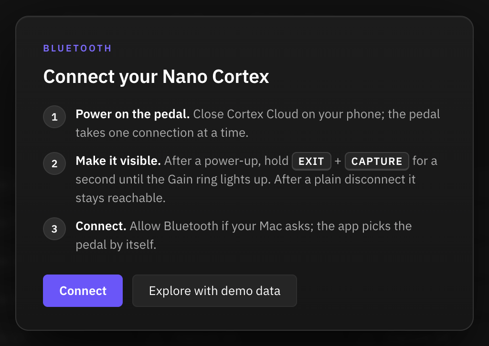

1. **Power on the pedal** and quit Cortex Cloud on your phone (or turn off the phone's Bluetooth). **The pedal accepts
   only one Bluetooth connection at a time**; while the phone holds it, the editor cannot see the pedal.
2. **Make it visible.** After a power-up, hold **EXIT** + **CAPTURE** for about a second, until the Gain ring lights
   up. After a plain disconnect from the editor it stays reachable without this.
3. **Click Connect.** The app scans for a few seconds and picks your Nano Cortex automatically. If it can't tell which
   device is the pedal, it shows a list to choose from. No USB cable is needed.

Once connected, the editor reads the current preset, the preset list, the slots and the library. The status bar shows
a green light and the pedal's name.

**Demo mode.** Click **Explore with demo data** to try everything without a pedal. The editor runs on sample presets
and a simulated pedal; nothing is sent anywhere. The status bar says "Demo data, nothing is sent". **Exit demo** in the
header returns to the connect screen.

**Reconnect at launch.** In [Settings](#12-settings) → Connection, turn on **Reconnect to the last pedal at launch**.
The app then connects to the pedal it used last as soon as it starts, without the list. **Forget pedal** clears the
remembered pedal.

## 3. Tour of the window

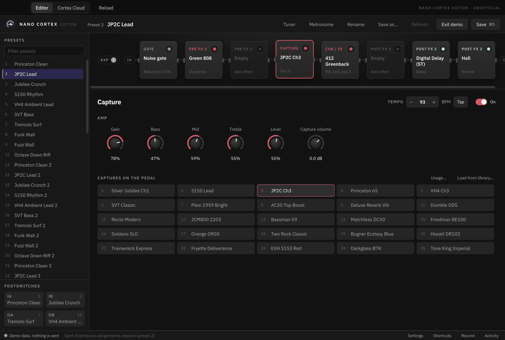

**Tabs.** The strip at the very top switches between the **Editor** and the **Cortex Cloud** website (⌘1 / ⌘2).
**Reload** reloads the editor page (you then reconnect).

**Header.**

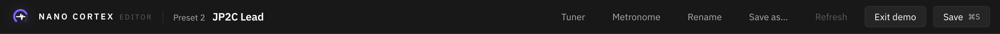

From left to right: the current preset's number and name; **Tuner**; **Metronome**; **Rename**; **Save as…**;
**Refresh** (re-reads everything from the pedal); **Connect** / **Exit demo**; and **Save**. When you have unsaved
edits, an orange **Unsaved changes** label appears, **Save** lights up and an outlined **Discard** button appears:

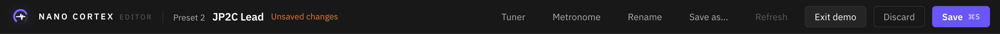

**Preset sidebar** (left): the filter box, the 64 presets (the current one highlighted) and, at the bottom, the
**Footswitches** strip.

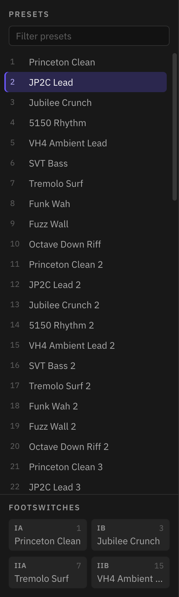

**Signal chain** (top): **EXP** (expression pedal assignments, with a count badge), then **In**, Gate, Pre FX 1,
Pre FX 2, Capture, Cab / IR, Post FX 1, Post FX 2, Post FX 3 and **Out**. Each node shows its stage, the effect or
capture name and a detail line; the dot in the corner is its on/off light. Click a node to select it.

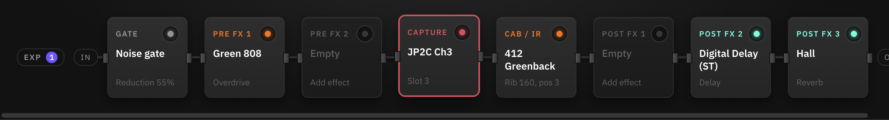

**Inspector** (middle): the controls for the selected stage. Its title row also holds the preset **Tempo** and the
stage's **On** switch.

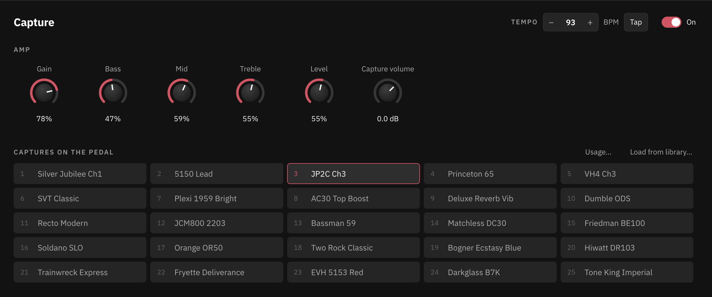

**Status bar** (bottom): connection state, the last action sent, and the **Settings**, **Shortcuts**, **Record** and
**Activity** buttons.

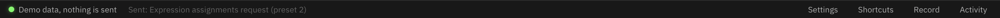

## 4. Presets

**Switching.** Click a preset in the sidebar, use ⌘↑ / ⌘↓, or arrow through the list when it has focus. Type in
**Filter presets** (⌘F) to narrow the list. Presets switch over Bluetooth; no MIDI or USB is involved.

**Unsaved changes.** Edits are live on the pedal as you make them, but they are only kept if you save. If you switch
presets with unsaved edits, the editor asks first:

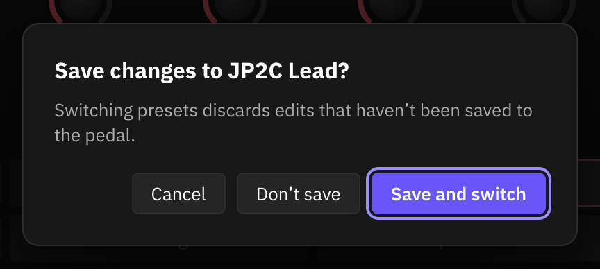

**Save and switch** saves, then switches; **Don't save** drops the edits; **Cancel** stays.

**Save** (⌘S) writes the current sound into the current preset. It only ever happens when you ask for it.

**Save as…** (⇧⌘S) writes the current sound, including unsaved edits, into another slot with a new name. The original
preset keeps what it had. Pick an empty slot (or one to overwrite), edit the name and click **Save to the chosen
slot**. The editor then switches to the new preset.

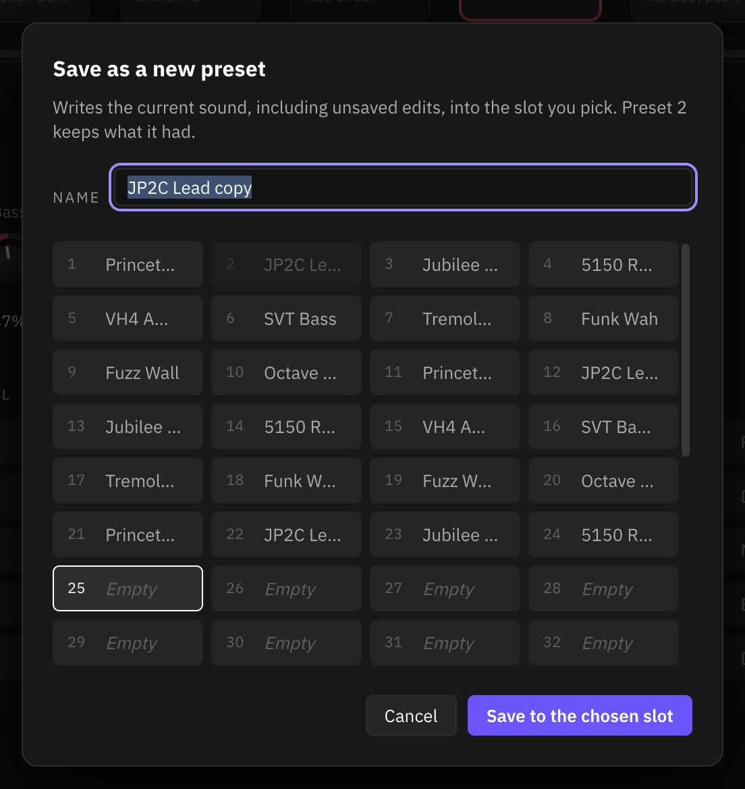

**Rename** (header button, or right-click a preset → **Rename…**) renames the preset on the pedal.

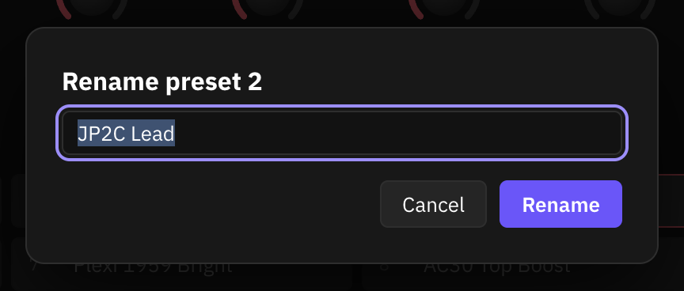

**Right-click a preset** for its menu: **Load**, **Rename…**, **Save current sound over this preset…**,
**Assign to footswitch IA / IB / IIA / IIB** and **Delete…**. On the current preset it also offers **Discard edits**.

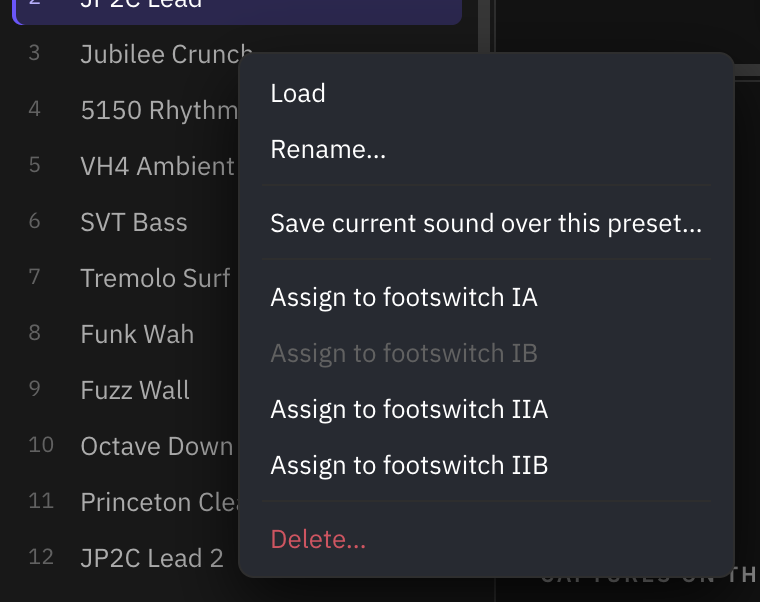

**Delete…** empties the slot on the pedal after you confirm. There is no undo; use **Save as…** first if you might
want it back.

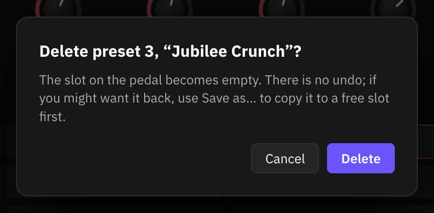

**Discard** (header button, shown only with unsaved edits) throws the edits away and reloads the preset as saved on
the pedal, after you confirm.

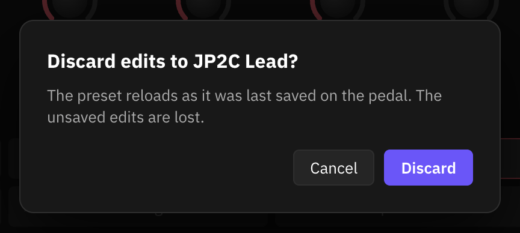

## 5. Editing blocks

Select a stage by clicking its node, pressing **1**–**8**, or **←** / **→**. Press **B** to bypass or turn on the
selected stage (or use the **On** switch in the inspector, or right-click the node). Every change goes to the pedal
straight away; **Save** keeps it.

**Knobs.**

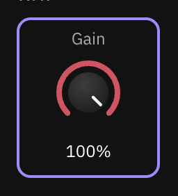

- Drag up or down, or scroll over it. Hold **Shift** for fine control.
- With the knob focused, use the arrow keys.
- **Double-click** to reset it to its default.
- **Click the value** below it to type an exact number, then press Enter.

**Gate.** The adaptive noise gate at the input. One knob, **Reduction**, plus the On switch.

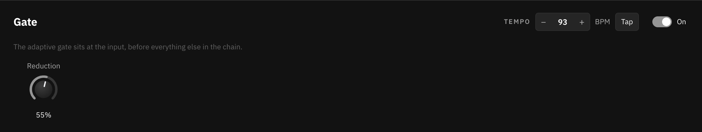

**Pre FX and Post FX.** Two effect slots before the capture and three after it. Each slot holds one effect; the
inspector shows its parameters as knobs, switches and menus (for example, a delay's **Sync** locks **Delay Time** to
the **Sync Note**). An empty slot says so and offers to add an effect.

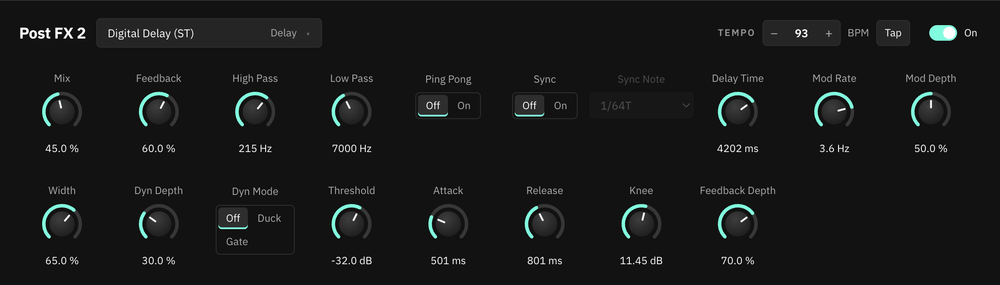

To change the effect, click the effect name in the inspector, press **M**, or right-click the node → **Change
effect…**. Type to search, then click an effect or press Enter. **None** empties the slot.

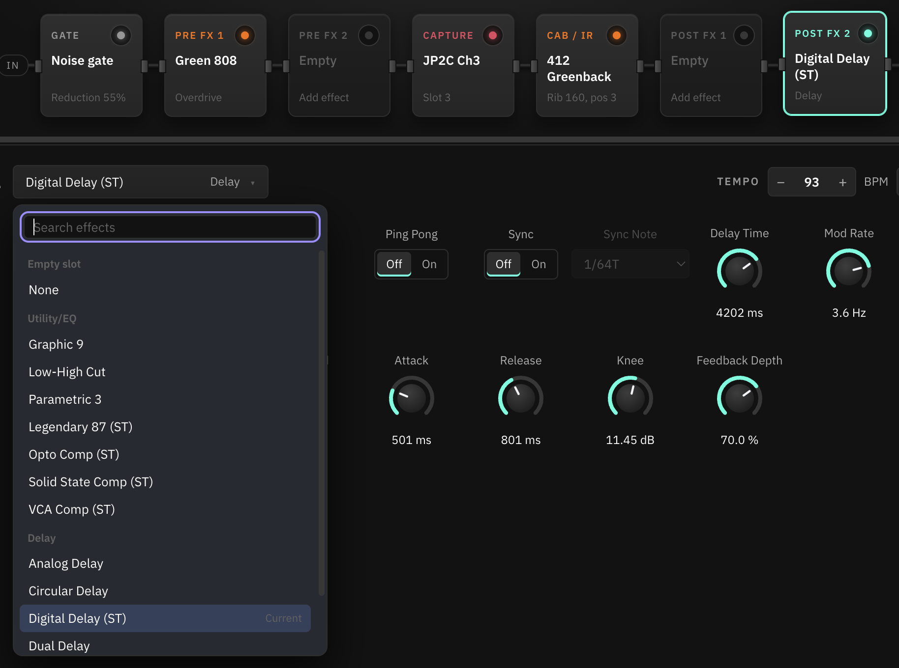

Right-clicking a node offers **Bypass** / **Enable**, **Change effect…** and **Clear slot**.

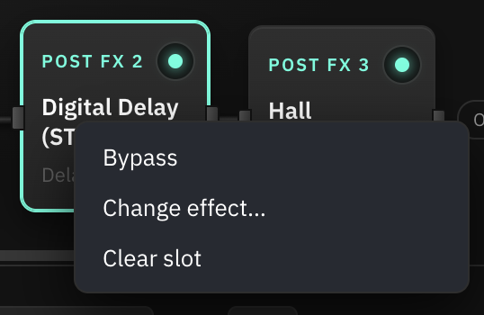

**Capture.** The amp knobs (**Gain**, **Bass**, **Mid**, **Treble**, **Level**) and **Capture volume**, then the
**Captures on the pedal**: 25 slots. Click a slot to load it into the preset.

**Load from library…** lists every capture stored in the pedal's library, factory captures first, then yours. Each
row shows icons for the kind of capture (amp head, combo, pedal, preamp, rack, power amp, full rig, cab) and the
instrument (guitar or bass), and the author. Pick one, then choose which slot to put it in. Loading into a slot
replaces that slot's capture for every preset that uses it.

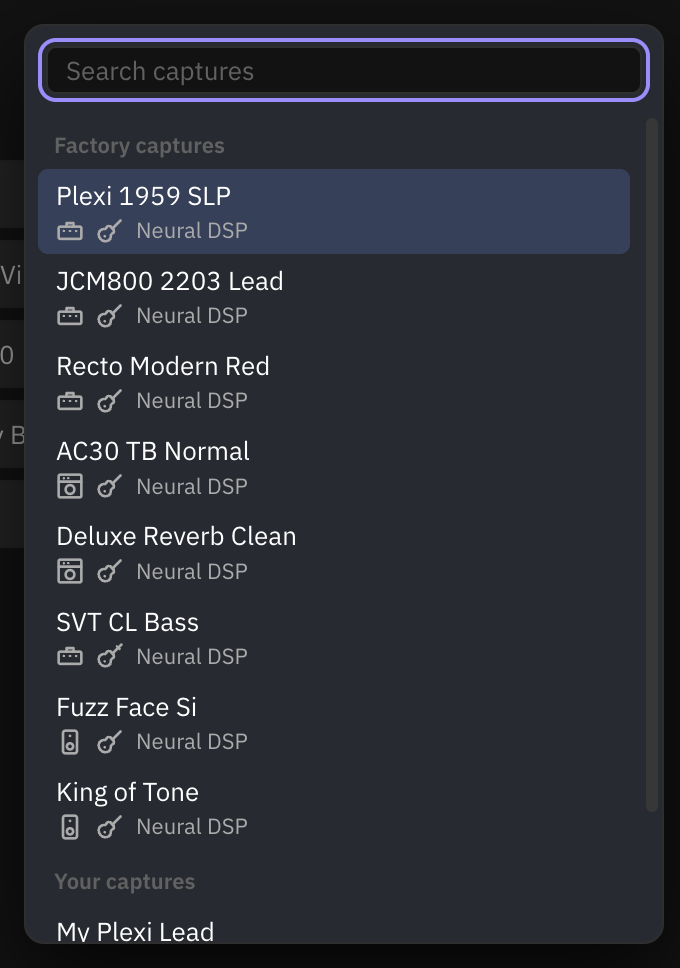

**Usage…** scans all presets (it switches through them and back, so it is only offered without unsaved edits) and
then shows, on each slot, how many presets use it, or "free". The slot chooser shows the same counts.

Right-click a slot for **Load**, **Put a library capture in slot N…** and **Info…**:

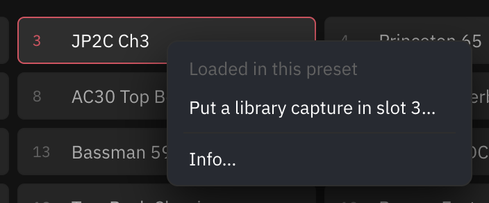

**Info…** asks the pedal for the capture's details: author, kind and instrument, tags, description and its hash
(**Copy** puts the full hash on the clipboard).

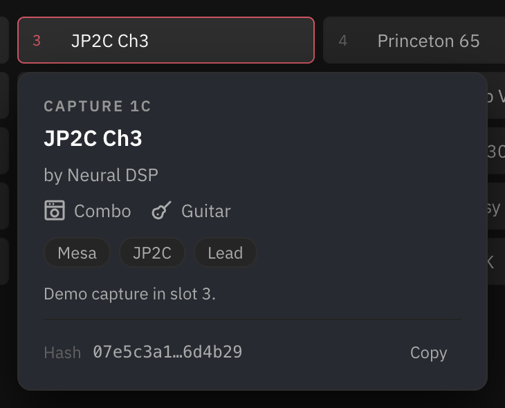

When a preset plays a capture straight from the library rather than from a slot, the node and inspector say
"From the library: *name*".

**Cab / IR.** **Level**, **High pass** and **Low pass**, then the **Microphone** (mic and position, for factory cabs),
then the **Cabs and IRs on the pedal**: five slots, with **Load from library…** as for captures. The microphone and
position are stored in the cab slot, so changing them affects every preset that uses that slot.

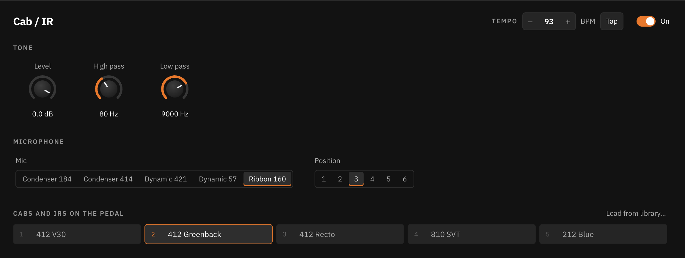

## 6. Footswitches

The **Footswitches** strip under the preset list shows which presets sit on the pedal's four footswitch slots in
4-Preset mode: **IA**, **IB**, **IIA** and **IIB**, each with the preset's number and name. The ones holding the
current preset are highlighted.

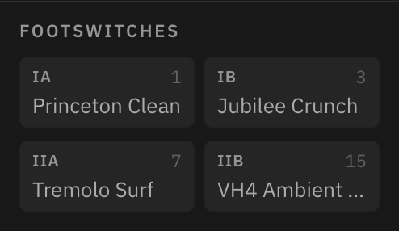

- **Click** a cell to load that preset.
- **Right-click** a cell → **Assign current preset**, or **Assign…** to pick any preset from a list.
- Or right-click a preset in the list → **Assign to footswitch …**.

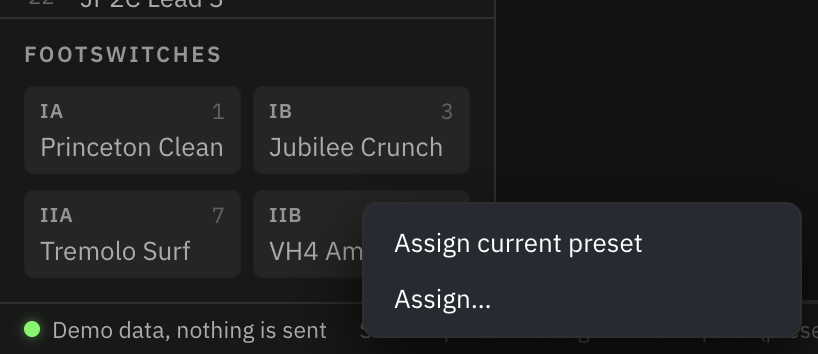

The pedal drops unsaved edits when an assignment changes, so with unsaved edits the editor asks first: **Save and
assign**, **Don't save** or **Cancel**. Assignments are stored right away; no Save is needed.

## 7. Expression pedal

Click **EXP** at the start of the chain (or press **E**) to open the preset's expression assignments in the inspector.
The badge on EXP shows how many there are. Assignments are per preset.

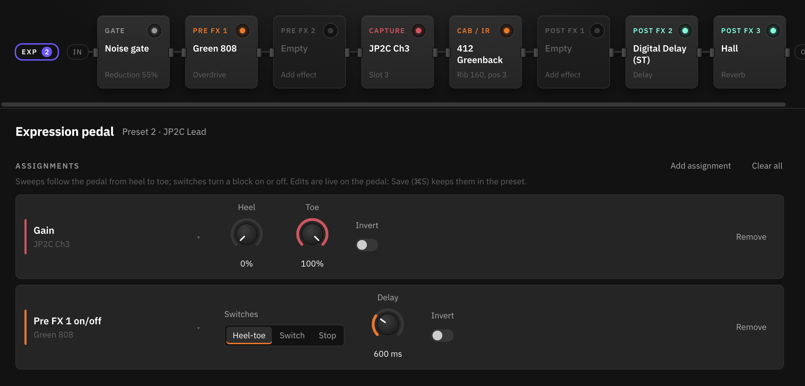

**Add assignment** offers the targets: sweeps (Gain, Bass, Mid, Treble, Capture volume, Gate reduction and each
effect slot's amount) and switches (Gate, Capture, Cab / IR or an effect slot on/off).

- **Sweeps** follow the pedal from heel to toe. Set the **Heel** and **Toe** values with their knobs; **Invert**
  swaps the direction.
- **Switches** turn a block on or off. Choose the mode, **Heel-toe**, **Switch** or **Stop** (the same modes as the
  pedal's own expression settings), the **Delay** before it switches, **Latch** and **Invert**. The panel shows only
  the options that apply to the chosen mode.
- Use the arrow on a row's name to move it to another target, **Remove** to delete it, and **Clear all** to remove
  every assignment.

Each change is live on the pedal and marks the preset as edited: **Save** keeps it.

## 8. Tempo

Every inspector's title row shows the preset's **Tempo** in BPM.

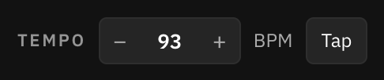

- **−** / **+** change it by 1 (Shift: 10). You can also type a value and press Enter, use the arrow keys, or drag
  the **TEMPO** label sideways.
- **Tap** sets it from your taps.
- Changes play on the pedal straight away and are written to the preset shortly after you stop adjusting; the preset
  then counts as edited and **Save** keeps the tempo.
- When the tempo changes on the pedal itself, the editor shows it.

The range is 30–300 BPM. The metronome can follow this tempo ([section 10](#10-metronome)).

## 9. Tuner

Press **T** or click **Tuner** in the header.

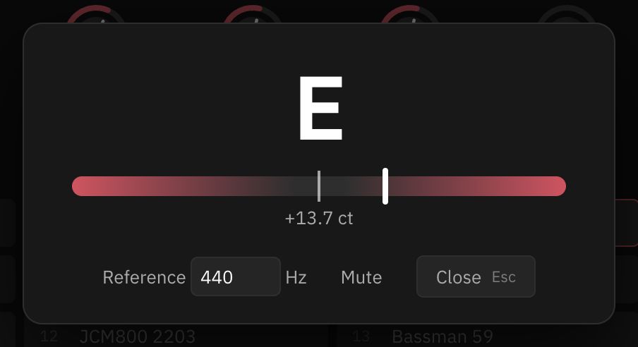

The tuner shows the note and how many cents sharp or flat you are; the needle centres when you are in tune. The pedal
only reports pitch while a string is sounding. Set the **Reference** (400–480 Hz, default 440) and click **Mute** to
silence the pedal's output while you tune. **Esc** or **Close** ends the tuner.

## 10. Metronome

Press **N** or click **Metronome**. The click plays from your computer, not from the pedal. **Space** starts and stops
it, **Esc** closes the panel; the switch at the top right chooses **Simple** or **Advanced**.

**Simple.**

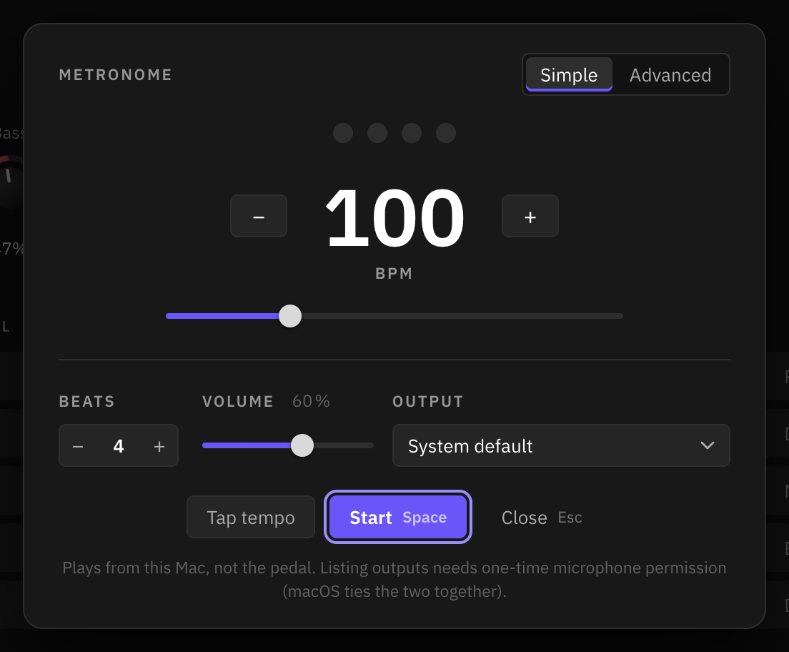

Set the tempo with **−** / **+** (Shift: ±10), by typing, with the slider or with **Tap tempo**. Choose the number of
**Beats** per bar, the **Volume** and the audio **Output**. The first time you open the output list, the system asks
for microphone permission; that is only how browsers reveal output names. Nothing is recorded.

**Advanced** adds everything for practice:

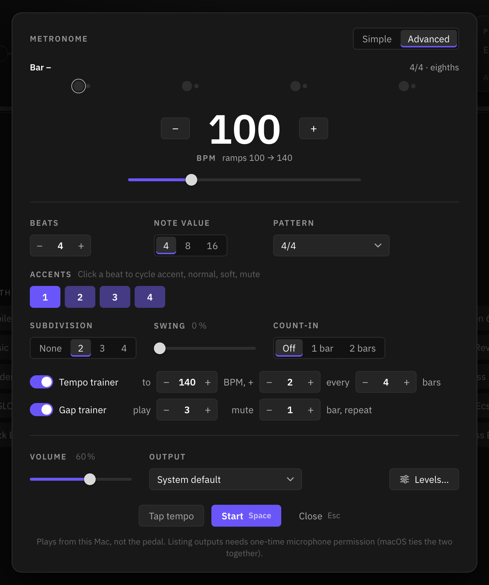

- **Beats** (1–16) and **Note value** (4, 8 or 16), or a **Pattern** preset (4/4, 3/4, 6/8, 5/4, 7/8, 12/8).
- **Accents**: click a beat to cycle it through accent, normal, soft and mute.
- **Subdivision**: none, 2, 3 or 4 clicks per beat, with **Swing** for the off-beats.
- **Count-in**: off, one or two bars of plain clicks before the pattern starts.
- **Tempo trainer**: from the current tempo **to** a target, adding a number of BPM **every** so many bars. The
  status beside BPM shows the ramp.
- **Gap trainer**: **play** a number of bars, then **mute** some, and repeat; the lights keep running in the gaps so
  you can check your time.
- A bar counter and the time signature sit above the beat lights.

**Levels…** sets the loudness of accents, main ticks and subdivisions, each relative to the overall volume:

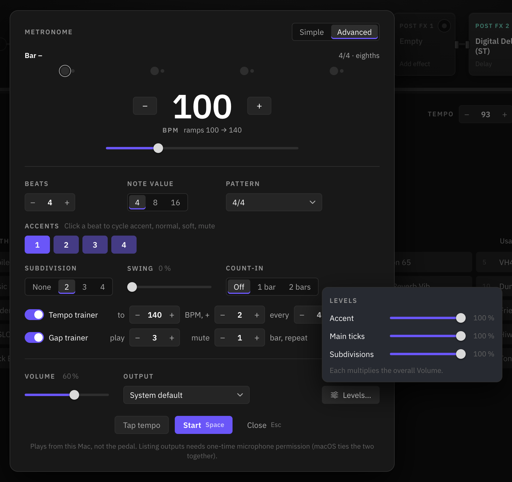

**Follow the preset tempo** ([Settings](#12-settings) → Metronome): when on and connected, the metronome plays the
current preset's tempo and follows preset changes, and changing the metronome's tempo writes it to the preset (Save
keeps it). The panel then says "♩ follows preset".

## 11. Cortex Cloud tab

The **Cortex Cloud** tab (⌘2) shows Neural DSP's own Cortex Cloud website inside the app.

- You **sign in on the site's own login page** with your own account. The editor never sees or stores your password;
  the site's session is kept in the app's own browser storage. **Sign out** in the toolbar clears it.
- **←**, **→**, **↻** and **Home** navigate the site. Links to other websites open in your default browser.
- Downloads from the site ask where to save.

**Sending a capture to the pedal.** Open a capture's page on the site (for example from Discover → Neural Captures).
**Send to Nano Cortex** in the toolbar lights up:

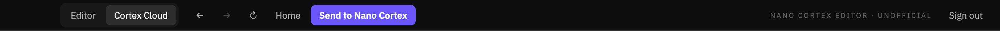

Click it. The app fetches the capture with your Cortex Cloud login and switches to the Editor, which asks you to
confirm:

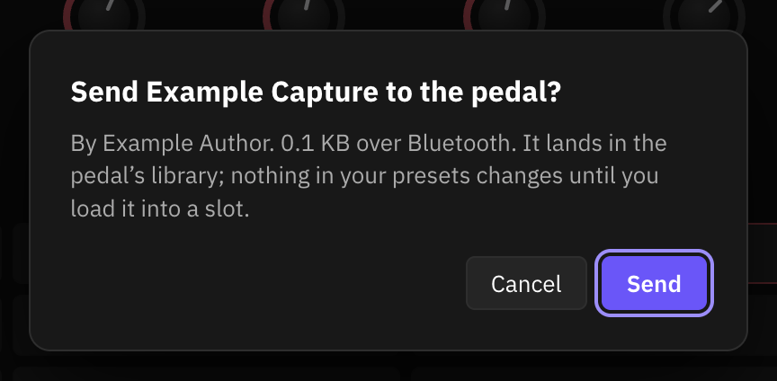

**Send** streams the capture to the pedal over Bluetooth. It lands in the pedal's **library** under your captures; no
preset changes. The editor then offers to load it into a slot right away (**Choose a slot**) or **Later** (it is in
**Load from library…** whenever you want it). The pedal must be connected; the phone app must not be.

Only captures can be sent for now; preset pages and IRs from Cortex Cloud still go through the official app.

## 12. Settings

Open Settings with ⌘, (Ctrl+, on Windows), from the app menu, or with **Settings** in the status bar.

**General**

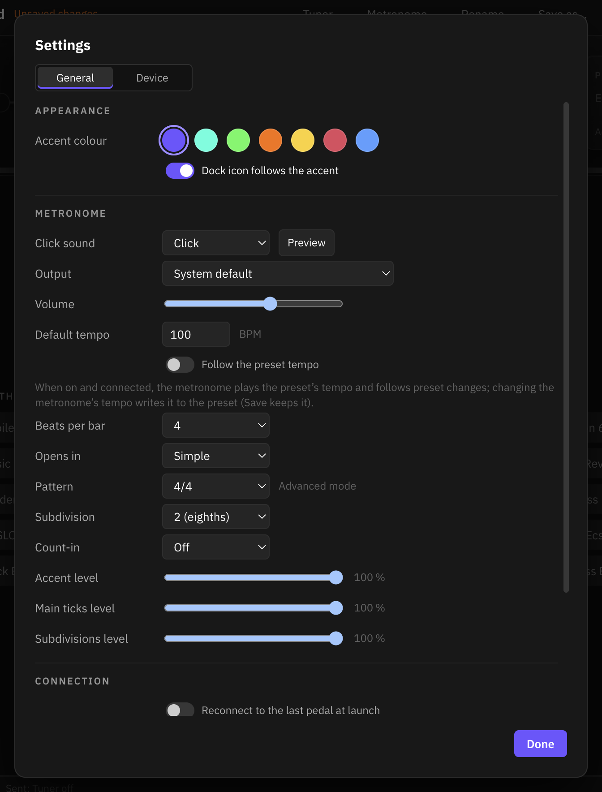

- **Appearance**: seven accent colours for highlights, buttons and the app icon. **Dock icon follows the accent**
  recolours the app icon too.
- **Metronome**: click sound (Click, Woodblock, Tick, Beep, Cowbell) with **Preview**, output, volume, default tempo,
  **Follow the preset tempo**, beats per bar, which mode the panel **Opens in**, and the Advanced defaults (pattern,
  subdivision, count-in and the three levels).
- **Connection**: **Reconnect to the last pedal at launch** and **Forget pedal**.
- **Advanced**: **Show the Activity drawer at launch** and **Show recordings folder**.

**Device** reads the pedal's own settings each time you open it.

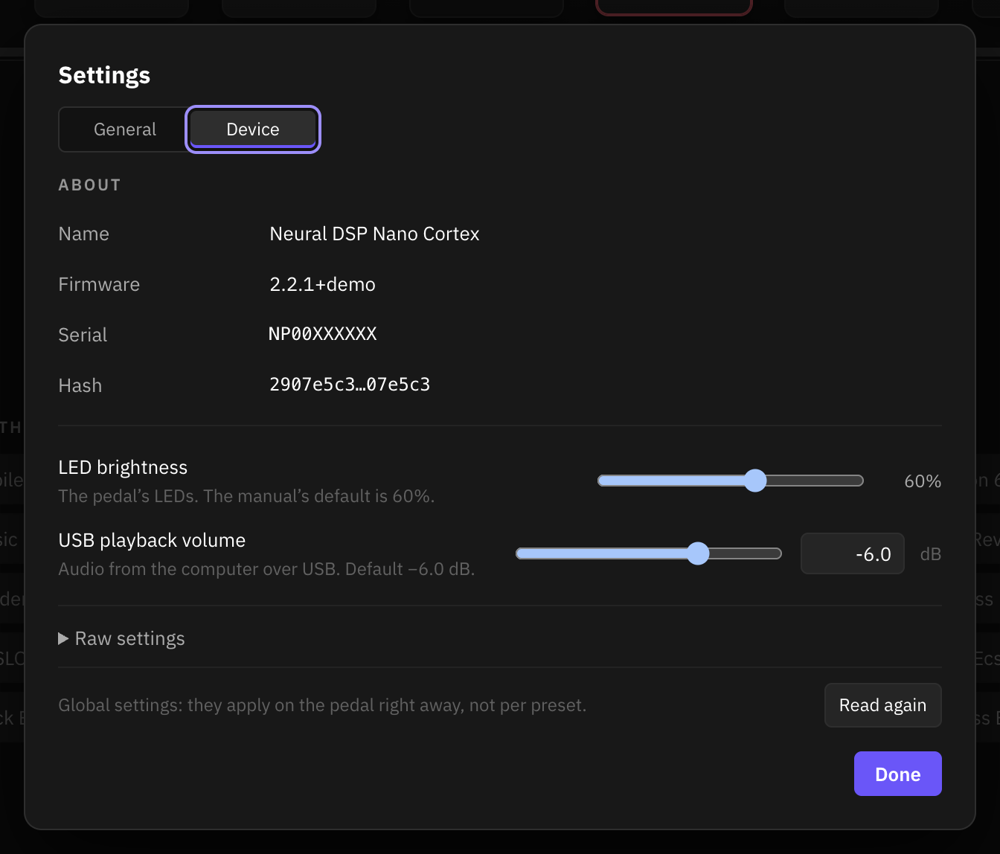

- **About**: the pedal's name, firmware, serial number and device hash.
- **LED brightness** (the manual's default is 60 %) and **USB playback volume** (audio from the computer over USB,
  default −6.0 dB). These are global settings: they apply on the pedal right away, not per preset.
- **Raw settings** lists the other values the pedal reports, read-only.
- **Read again** refreshes everything.

## 13. Session recording and the Activity log

**Activity** in the status bar (⌘L) opens the Activity log: every Bluetooth message sent (TX) and received (RX), with
a plain-language line for each one the editor understands.

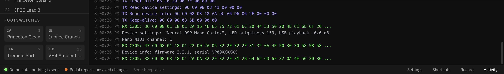

**Record** in the status bar captures every packet in both directions, with timestamps and the log. Click it again to
stop; the app asks where to save the JSON file (your Downloads folder by default). Recordings help with bug reports,
but they contain your preset names and the pedal's serial number: check before you share one, and attach only what is
needed.

## 14. Keyboard shortcuts

Press **?** (or **Shortcuts** in the status bar) for this list in the app. On Windows use Ctrl for ⌘.

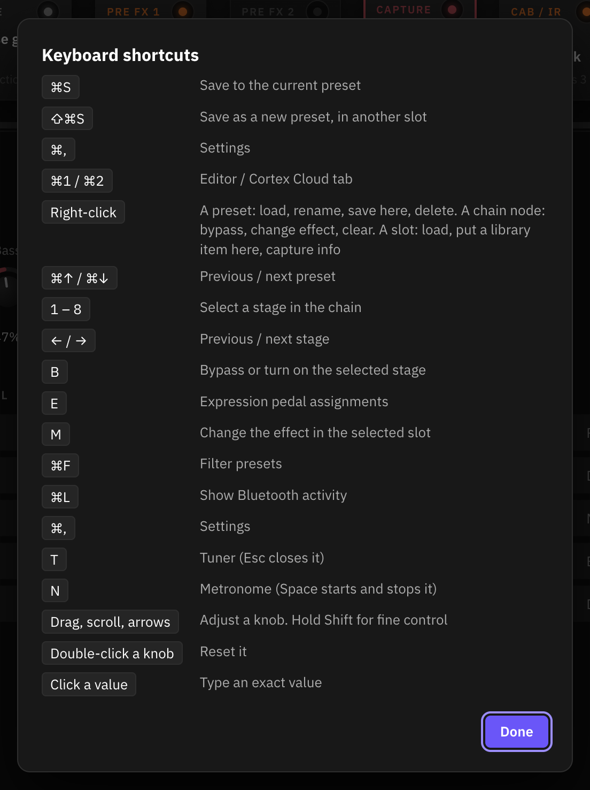

| Keys | Action |
|---|---|
| ⌘S | Save to the current preset |
| ⇧⌘S | Save as a new preset, in another slot |
| ⌘, | Settings |
| ⌘1 / ⌘2 | Editor / Cortex Cloud tab |
| Right-click | A preset: load, rename, save here, assign to a footswitch, delete. A chain node: bypass, change effect, clear. A slot: load, put a library item here, capture info |
| ⌘↑ / ⌘↓ | Previous / next preset |
| 1–8 | Select a stage in the chain |
| ← / → | Previous / next stage |
| B | Bypass or turn on the selected stage |
| E | Expression pedal assignments |
| M | Change the effect in the selected slot |
| ⌘F | Filter presets |
| ⌘L | Show Bluetooth activity |
| T | Tuner (Esc closes it) |
| N | Metronome (Space starts and stops it) |
| Drag, scroll, arrows | Adjust a knob; hold Shift for fine control |
| Double-click a knob | Reset it |
| Click a value | Type an exact value |
| ⌘R | Reload the current tab |

## 15. Troubleshooting

**"No Nano Cortex showed up nearby."**
- Make sure the pedal is on and the Cortex Cloud phone app is **not** connected to it (quit the app or turn off the
  phone's Bluetooth). The pedal takes one connection at a time.
- After a power-up, hold **EXIT** + **CAPTURE** for a second until the Gain ring lights up, then click **Connect**
  again. The first scan after the pedal boots can come up empty; try once more.
- Move closer; Bluetooth LE range drops behind walls and racks.

**"The pedal dropped the connection."** Usually the phone app grabbed it. Close it and connect again.

**"Bluetooth is off or unavailable."** Turn Bluetooth on (macOS: Control Centre; Windows: Settings → Bluetooth &
devices). Windows needs a Bluetooth 4.0 (LE) adapter.

**macOS: Connect does nothing / Bluetooth permission.** Open **System Settings → Privacy & Security → Bluetooth** and
make sure **Nano Cortex Editor** is allowed, then quit and reopen the app.

**macOS: "Nano Cortex Editor can't be opened" / "Apple could not verify…".** The app is unsigned. Right-click it in
Applications → **Open**, or use **System Settings → Privacy & Security → Open Anyway** (see
[section 1](#1-install-and-first-launch)).

**Windows: SmartScreen blocks the app.** Click **More info → Run anyway**.

**Something on screen doesn't match the pedal.** Click **Refresh** in the header to re-read everything. If the problem
stays, open the Activity log (⌘L) and include the relevant lines in a bug report.

**Reconnect at launch doesn't find the pedal.** The pedal needs to be on and visible before the app starts; otherwise
click **Connect** once it is.

**The metronome is silent.** Check the Volume and Output in the panel (and Levels in Advanced mode), and that the gap
trainer isn't in a muted bar.

**Reporting a bug.** Open an [issue](https://github.com/AJs-Creations/nano-cortex-editor/issues) with your system,
the app version (About), the pedal's firmware (Settings → Device) and an Activity log excerpt.

## 16. FAQ

**Is this official?** No. It is an independent, open-source project, not affiliated with or endorsed by Neural DSP.

**Does it need a USB cable or MIDI?** No. Everything, including preset switching, goes over Bluetooth.

**Can I use it and the phone app at the same time?** No; the pedal accepts a single Bluetooth connection. Disconnect
one before using the other.

**Are my edits saved automatically?** Edits play on the pedal immediately but are only stored when you press **Save**
(or choose **Save and switch** / **Save and assign**). Footswitch assignments and Device settings apply right away.

**Will it break my pedal?** It uses the same Bluetooth messages as the official app. Still, back up your presets
first, and report anything odd.

**Which firmware is supported?** It was developed and tested against Nano Cortex firmware 2.2.1. Other versions may
work but are untested.

**Does the app see my Cortex Cloud password?** No. You sign in on the website's own page; the app only uses the
resulting session to download a capture when you click **Send to Nano Cortex**.

**Can I send IRs or presets from Cortex Cloud?** Not yet; only captures. Use the official app for those.

**Is there a Mac-native version?** Yes:
[Nano Cortex Editor for Mac](https://github.com/AJs-Creations/nano-cortex-editor-mac), with the same features.

**What is View → Classic Editor?** The original community editor by DrD85 that this app's protocol layer comes from,
kept as a fallback.

## 17. Trademark note

Neural DSP and Nano Cortex are trademarks of Neural DSP Technologies Oy; this project is not affiliated with or
endorsed by Neural DSP. Quad Cortex, Neural Capture and Cortex Cloud are also Neural DSP trademarks, named only to
describe compatibility. The Cortex Cloud tab displays Neural DSP's own website; this manual describes it but does not
reproduce it.
